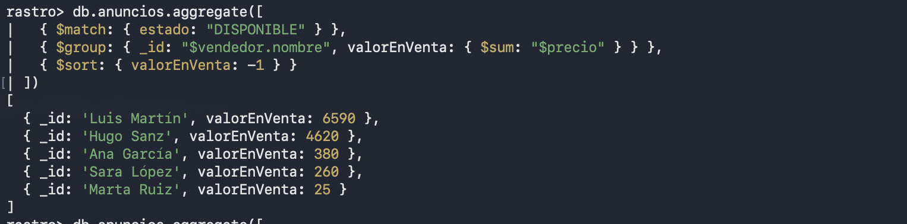

# Entrega MongoDB Rastro

## Parte A

### A1

1. Si cada atributo es una columna: id, titulo, categoria + marca, modelo, anio, km, combustible, almacenamiento_gb, bateria_pct, talla, genero, material, ancho, fondo, alto. Son 16 (marca la he contado una vez aunque salga en coches, moviles y ropa). Con el resto de campos (descripcion, precio, estado...) serian bastantes mas.

2. La chaqueta solo rellena marca (Levi's), talla (M) y genero (unisex). Todo lo demas (modelo, anio, km, combustible, almacenamiento, bateria, material, ancho, fondo, alto) se queda a NULL, o sea 10 columnas vacias.

3. Habria que hacer un ALTER TABLE para añadir las columnas de la bici (tipo, pulgadas rueda). Y eso cada vez que salga una categoria nueva, y todas las filas que ya habia se llenan de mas NULL.

4. 4 JOIN, uno por cada tabla de categoria (coches, moviles, ropa, muebles). Y si sale otra categoria, otro JOIN mas.

5.
```js
{ titulo: "iPhone 13 128 GB", categoria: "Móviles", precio: 380,
  atributos: { marca: "Apple", modelo: "iPhone 13", almacenamientoGB: 128, bateriaPct: 87 } }

{ titulo: "Mesa de comedor de roble", categoria: "Muebles", precio: 120,
  atributos: { material: "roble", ancho: 160, fondo: 90, alto: 75 } }
```
Cada uno con sus atributos y ya, sin NULLs.

### A2

1. Porque el usuario no es solo del anuncio, tambien hace ofertas, valoraciones, tiene mas anuncios... Si lo metemos entero estaria repetido en todos sus anuncios. Y ademas se veria el email en la ficha, que es publica.

2. El nombre es lo que se enseña en la ficha. El email no se enseña y la ciudad ya la tiene el anuncio.

3. En usuarios, en sus anuncios (vendedor.nombre), en sus ofertas (comprador.nombre) y en las valoraciones que haya escrito (autor.nombre).

4. En el gimnasio teniamos monitor_id en clases y el nombre lo sacabamos con un JOIN, asi que solo estaba en un sitio. Aqui lo copiamos, entonces no hace falta JOIN para leerlo pero si cambia hay que cambiarlo en todas partes.

### A3

1. En otra coleccion. La ficha no necesita las ofertas, y el comprador tambien tiene que poder ver sus ofertas ("mis ofertas"). Ademas un anuncio puede tener muchas.

2.
```js
{
  importe: 340,
  estado: "PENDIENTE",
  fecha: new Date("2026-10-27"),
  anuncio: { id: ObjectId("670000000000000000000003"), titulo: "iPhone 13 128 GB", precio: 380 },
  comprador: { id: ObjectId("660000000000000000000005"), nombre: "Sara López" }
}
```

3. Del anuncio el titulo y el precio (ademas del id), y del comprador el nombre.

4. No, el precio que se guarda es el que tenia cuando se hizo la oferta. Es como el precio en las lineas de pedido de Furniro, se queda como estaba.

### A4

1. Aparte. Un usuario puede tener muchisimas valoraciones y el documento no puede pasar de 16MB. Ademas tienen que ver con dos usuarios y un anuncio, no solo con uno, y asi puedo poner el indice unico.

2.
```js
{
  anuncioId: ObjectId("670000000000000000000004"),
  autor: { id: ObjectId("660000000000000000000004"), nombre: "Hugo Sanz" },
  valoradoId: ObjectId("660000000000000000000003"),
  estrellas: 5,
  comentario: "Todo perfecto",
  fecha: new Date("2026-09-15")
}
```

3. autor.id + anuncioId

4. valoracionMedia y numValoraciones. Con eso se calcula la media nueva sin mirar todas: (media * num + estrellas) / (num + 1)

### A5

1. Un usuario tendra pocos favoritos (decenas), pero un anuncio puede estar en favoritos de miles de personas.
2. La b, porque el array de usuarios en el anuncio no para de crecer.
3. La a, guardo los ids en el usuario y luego busco los anuncios con $in.
4. `db.usuarios.countDocuments({ favoritos: ObjectId("670000000000000000000008") })`
5. $addToSet

### A6

1. Chat: aparte, puede haber muchisimos mensajes.
2. Direccion de envio: dentro de la compra, es la de ese momento.
3. Etiquetas: dentro, son pocas.
4. Categorias: aparte, son de todos los anuncios.
5. Historial de precios: dentro del anuncio, no seran muchos cambios.
6. Anuncios del usuario: aparte, ya tienen el id del vendedor.
7. Lineas de pedido: dentro del pedido.
8. Reseñas de producto: aparte, pueden ser miles. En el producto solo la media.

### Diferencias con el modelo (apartado 9)

Me ha salido practicamente igual que el modelo: fotos dentro del anuncio, vendedor con id + nombre, ofertas y valoraciones en su coleccion y favoritos como array en el usuario. Lo unico que yo añadiria seria el historial de precios dentro del anuncio.

## Parte B

### B2.3

No he tenido que cambiar nada, se ha insertado sin mas. En PostgreSQL habria dado error porque las columnas de la bici no existen, habria que hacer antes el ALTER TABLE.

### B4

B4.1: pensaba que daria error y si, sale E11000 duplicate key por el indice unico del email.

B4.2: igual, E11000 por el indice de B3.2 (autor + anuncio).

B4.3: aqui no estaba seguro, pensaba que daria error pero se guarda sin problema. Mongo no mira si el vendedor existe porque no hay claves ajenas.

B4.4: se guarda, pero luego en el find de menos de 100 no sale la lampara porque el precio es texto.

B4.5: pensaba que cambiaria el precio y no, da error "Update document requires atomic operators". Falta el $set.

B4.6: pensaba que lo encontraria pero sale null, el _id es un ObjectId y no un string.

B4.7: En el gimnasio daba error de clave ajena y no se guardaba. Aqui lo tiene que comprobar la aplicacion antes de insertar.

B4.8: Porque "75" es texto y $lt: 100 compara numeros, entonces no entra.

B4.9: Mongo no comprueba ni las referencias ni los tipos de los campos, guarda lo que le mandes. Solo controla lo que le pongas tu con indices unicos (o con validacion, que lo he probado en el reto 4).

### B5.12

No da error, simplemente no salen porque no tienen el campo km.

### B7.4

Son 2 instrucciones, una en ofertas y otra en anuncios. Si se va la luz despues de la primera, la oferta queda aceptada pero el anuncio sigue disponible y no cuadra. Para eso habria que usar transacciones (necesitan replica set).

### B8

1. Porque cada categoria tiene atributos diferentes y en mongo no hay que cambiar nada para meter categorias nuevas. Y la ficha se lee entera de una vez.
2. Los pagos y todo lo que sea dinero, ahi es mejor que la base de datos no deje meter datos mal.
3. Las fotos son parte del anuncio y son pocas (max 10). Las ofertas son tambien del comprador y pueden ser muchas.
4. Porque es el precio que habia cuando se hizo la oferta, y asi en "mis ofertas" no hay que ir a buscar el anuncio.
5. Desnormalizar es copiar datos en varios sitios. Lo bueno es que lees todo de una vez, lo malo es que si cambia hay que cambiar todas las copias (como el nombre de Luis en B7.6, que tuve que cambiarlo en 4 colecciones).
6. La aplicacion, mongo no lo hace.

## Captura B6.4


